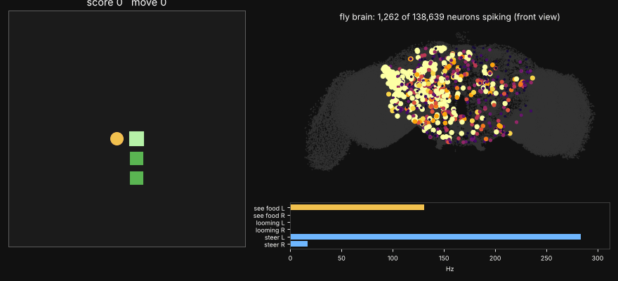

# 초파리 뇌가 하는 스네이크

FlyWire 초파리 커넥톰(v783, 뉴런 138,639개 · 연결 1,500만 개)으로 만든 뇌 전체 LIF 모델이 스네이크를 합니다.
뉴런 모델과 파라미터는 Shiu et al. 2024 (Nature)와 같고, `brain.py`에서 numpy로 다시 구현했습니다.



## 동작 방식
- 먹이가 왼쪽/오른쪽에 보이면 그쪽 눈의 **LC10**(작은 물체 감지) 시각뉴런을 Poisson 자극합니다.
- 장애물이 바로 옆/앞에 있으면 **LC4 · LPLC2**(다가오는 물체 감지) 뉴런을 자극합니다.
- 뇌를 200 ms 시뮬레이션한 뒤 조향 하강뉴런 **DNa01 + DNa02** 중 더 많이 발화한 쪽으로 꺾습니다.
- 게임 코드는 먹이 위치로 방향을 정하지 않습니다. "LC10은 같은 쪽으로 돌고, LC4/LPLC2는 반대쪽으로 돈다"는 관계는 커넥톰에서 나온 결과입니다.

## 실행
```bash
./setup_data.sh                 # 데이터 받기 (약 200 MB)
python snake.py --moves 100 --seed 1
```
결과는 `results/`에 저장됩니다.
